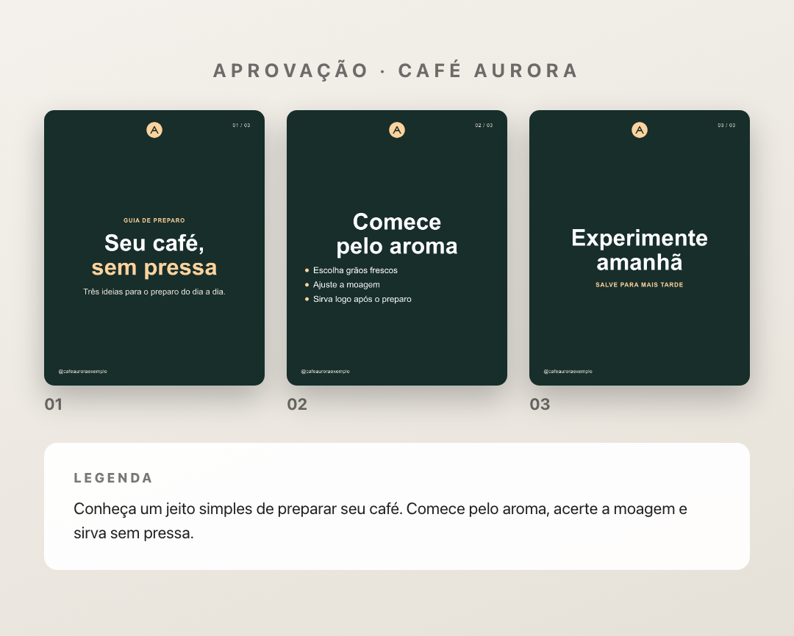

# Broadway Dev Tools

Ferramentas de código aberto da Broadway Mídia para produção de conteúdo.

- [Broadway Creative Lab](creative-lab/) — plugin para Claude Code e
  renderizador de criativos com guias de marca, mockups e conferência
  automática.
- [Estúdio de vídeo](video-studio/) — motor em Python e FFmpeg que transforma
  imagens e textos em um vídeo vertical.

Cada ferramenta inclui instruções para reproduzir o exemplo Café Aurora,
uma marca fictícia com materiais criados para as demonstrações.

## Demonstração do Creative Lab

Carrossel de três slides gerado localmente em um Mac com a versão pública do Creative Lab. Café Aurora é uma marca fictícia.

[Reproduza o exemplo com as instruções do Creative Lab](creative-lab/).

## Licença

O código deste repositório é distribuído sob a [licença MIT](LICENSE).
